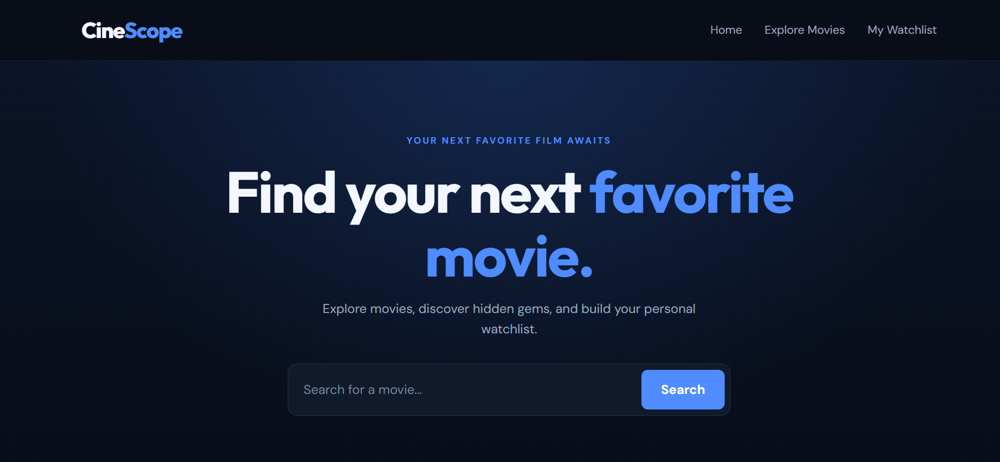
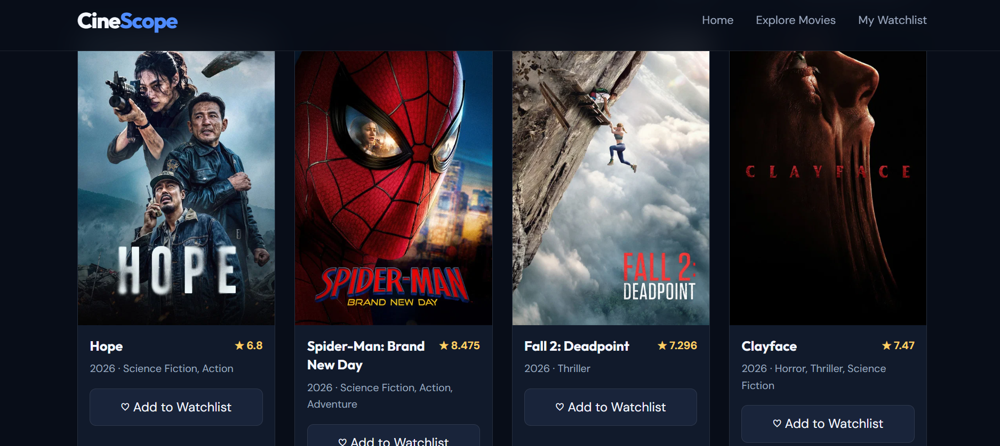

## CineScope 

CineScope is a movie discovery website I built using HTML, CSS, and JavaScript. It uses the TMDB API to display movie information and lets users search for films, explore details, and keep track of their favorites.

## Preview

### Home Page

### Movie Cards

## Features

- Browse popular movies
- Search for movies by title
- Filter movies by genre and sort results
- Load more search results
- View movie details
- Save favorite movies to a watchlist
- Watch available movie trailers
- Save favorites using browser local storage

## Built With

- HTML
- CSS
- JavaScript
- TMDB API
- Local Storage

## Run Locally

1. Clone or download this repository.
2. Get an API key from [TMDB](https://www.themoviedb.org/settings/api).
3. Open `script.js` and replace the placeholder in `API_KEY` with your own key.
4. Open the project using a local server, such as Live Server in Visual Studio Code.

The movie data won't load until a valid API key is configured.

**Security note:** Don't commit your personal API key to this public repository.

## API Attribution

Movie information and images are provided by [The Movie Database (TMDB)](https://www.themoviedb.org/).

This product uses the TMDB API but is not endorsed or certified by TMDB.

## About the Project

I built CineScope to practise JavaScript, work with an external API, and learn how to build an interactive website. I'm continuing to improve it as I develop my frontend and full-stack skills.
